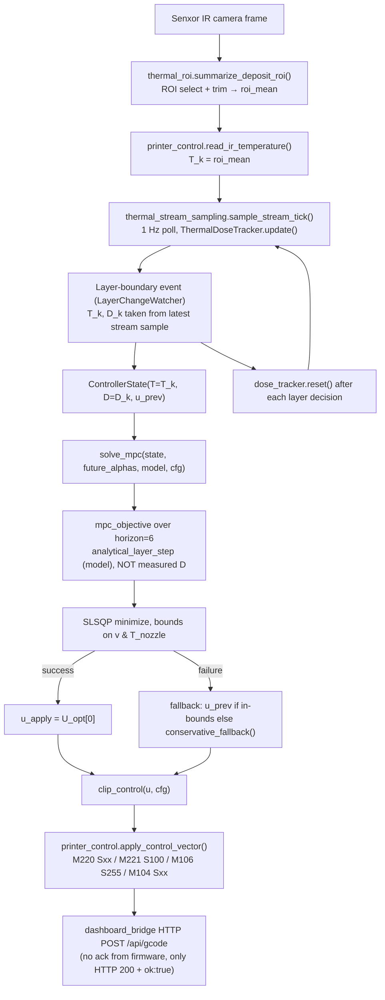

# MPC Focused Code Review

Scope: read-only static review + safe offline unit tests + one offline numerical sweep of `solve_mpc()`. No G-code sent, no hardware/network contacted, no source files modified.

## 1. Executive Summary

- **Internal software consistency:** Good. `mpc_controller.py`, `thermal_model.py`, `thermal_dose.py`, `thermal_targets.py`, `printer_control.py`, and `thermal_layer_logger.py` agree on the control vector `u = [v_mm_s, T_nozzle_C]`, fan locked at 100%, dwell locked at 0, and per-layer (not cumulative) thermal dose. All 29 **selected** unit tests (six test modules: `test_mpc_controller`, `test_thermal_model`, `test_thermal_dose`, `test_printer_control`, `test_thermal_stream_sampling`, `test_thermal_targets`) pass unmodified — this is not the full repository test suite (see §8).
- **Genuinely closed-loop MPC?** Partially. `solve_mpc()` is a real receding-horizon nonlinear program (SLSQP over a 6-step horizon, warm-started, with a fallback path). But the loop only closes on **temperature** — the measured dose (`ControllerState.D`) is accepted into the state object and logged, but is **never read by `mpc_objective` or the prediction model** (see §7, Q1). Dose enters the optimizer only through the *predicted* per-layer dose recomputed from zero each horizon step, not the measured one. So this is closed-loop MPC on `T`, open-loop (predictive only) on `D`.
- **Offline-analysis readiness:** Ready with caveats. The model, objective, calibration, and analysis code are self-consistent and testable without hardware, but the calibration pipeline itself pairs measurement and prediction intervals that don't match (F7) and the dose target derivation uses a speed outside the actuator range (F8) — both should be fixed before offline results are trusted quantitatively.
- **Printer-test readiness:** Not yet, pending fixes in §10 "before any physical printer run" — most importantly the unused-`D` gap, the calibration timing mismatch (F7), the speed-model/G-code mismatch (F9), the fan experiment-configuration conflict (F10), and the fact that G-code sends are fire-and-forget with no acknowledgement of actual print-firmware state (§7, Q12).
- **Research/publication readiness:** Not yet. The thermal model has never been calibrated against real hardware in this repo (no committed `thermal_fit.json`/fit report), the calibration procedure as written mismatches measured and predicted time intervals (F7), the dose target was derived using a speed outside the feasible control range (F8), dose-window reachability under the current bounds is only weakly demonstrated (`test_dose_targets_reachable_in_sim` accepts >30% in-window as a pass), and there is an unresolved conflict between fan-on Python defaults and fan-off G-code/tooling in the repo (F10).

## 2. Repository and File Responsibilities

| File | Role |
|---|---|
| `thermal_targets.py` | Pure functions: `T*(α)`, dose target `D*(α)`, dose window `[D_low, D_high]`, bond/sag soft limits — all linear in overhang angle α. |
| `thermal_dose.py` | `ThermalDoseTracker`: stateful integrator `D += dt·max(T−T_g,0)`, used only in the **live** 1 Hz stream path, not inside the MPC objective. |
| `thermal_model.py` | Reduced-order analytical plant: one substep (`analytical_thermal_step`) and an N-substep layer integrator (`analytical_layer_step`) used both for MPC prediction and for `least_squares` calibration (`fit_thermal_model`). |
| `mpc_controller.py` | `MPCConfig` (bounds/weights), `ControllerState`, `mpc_objective`, `solve_mpc` (SLSQP + fallback), plus offline simulators (`simulate_closed_loop_mpc`, `simulate_fixed_baseline`) and metrics (`summarize_history`, `short_horizon_prediction_error`). |
| `thermal_stream_sampling.py` | 1 Hz IR polling between layer-change events; feeds `ThermalDoseTracker` and writes `stream.csv`. |
| `thermal_layer_logger.py` | Orchestrator: watches OctoPrint layer changes, samples the stream, builds `ControllerState`, calls `select_control` → `solve_mpc`, applies controls, logs `log.csv`, resets the dose tracker per layer. |
| `printer_control.py` | Bridge HTTP client: reads Senxor IR frame + ROI, builds/sends `M220/M221/M106/M104` G-code, publishes dashboard status. |
| `baseline_controllers.py` | `fixed_control` / `clip_control` — non-MPC baseline for comparison studies. |
| `calibrate_thermal_model.py` | Offline CLI: loads logged `log.csv` rows, fits `ThermalModelParams` via `least_squares`, reports RMSE/R²/e_N. |
| `thermal_roi.py` (traced, not primary) | Extracts `roi_mean/max/min/std` from the raw Senxor thermal matrix; this is the source of `T_k`. |
| `rl_layer_logger.py` (traced only, not run) | Supplies `LayerChangeWatcher`, `read_printer_temps`, `test_connections`, run-folder naming — all network/OctoPrint-facing; only grepped for signatures, never executed. |

## 3. End-to-End MPC Workflow



## 4. Mathematical Reconstruction

**State variables** (`ControllerState`, mpc_controller.py:53-59):
- `T` — IR ROI-mean temperature, °C (carried across the horizon during prediction)
- `D` — last measured per-layer thermal dose, °C·s (stored, **not used** in objective/prediction — see §7 Q1)
- `u_prev` — last applied control `[v_mm_s, T_nozzle_C]`

**Measured variables:** `T_k = roi_mean` (thermal_roi.py), `D_k` from `ThermalDoseTracker` (thermal_dose.py), hotend/bed actual/target (from bridge, logged but not fed to the optimizer).

**Control inputs:** `u = [v_mm_s, T_nozzle_C]`, 2 per horizon step, 12 decision variables total for `horizon=6`.

**Overhang-angle input:** `alpha_deg`, exogenous per-layer scalar, held constant across the horizon in the live path (`select_control` passes `[alpha_deg] * cfg.horizon`, thermal_layer_logger.py:166,185) — i.e. no angle *lookahead* is actually used online, only in the offline `simulate_closed_loop_mpc` demo which ramps `alpha`.

**Prediction horizon:** `cfg.horizon = 6` decision steps (mpc_controller.py:25), each step representing one "layer-scale" interval of length `segment_length_mm = 300` mm, integrated with `n_substeps = 12` sub-steps.

**Thermal model** (thermal_model.py:37-71), per substep of length `dt = seg_len/v`:
```
fan = 1.0                                     (hard-coded, not a control variable)
alpha_norm = clamp(alpha_deg, 0)/90
tau_eff = tau0 / (1 + a_fan·fan + a_alpha·alpha_norm)
T_deposit_eff = T_nozzle − a_v·v
T_plus = (1−β)·T + β·T_deposit_eff
T_next = T_inf + (T_plus − T_inf)·exp(−dt/tau_eff)
D_next = D + dt·max(0.5·(T+T_next) − T_g, 0)
```
Default params: `T_inf=25, T_nozzle=215, T_g=60, β=0.35, a_v=0.15, tau0=8.0, a_fan=2.0, a_alpha=0.4`.
`analytical_layer_step` runs this substep 12× per decision, restarting `D_layer` at 0 each call (thermal_model.py:115) — dose is **always** computed as a fresh per-layer integral, both in prediction and in the live tracker (which is reset every layer, thermal_layer_logger.py:410).

**Thermal-dose equation** (thermal_dose.py:36): `D += dt·max(T − T_g, 0)`, T_g = glass transition temp (60 °C default).

**Target equations** (thermal_targets.py, all linear in `max(α−45,0)`):
```
T*(α)      = 145.0 − 0.45·max(α−45,0)
D*(α)      = 730.0 − 6.0·max(α−45,0)
[D_low,D_high] = D*(α) ± 180.0  (clamped ≥0)
T_bond(α)  = 95.0  − 0.35·max(α−45,0)     (soft lower T limit)
T_sag(α)   = 175.0 − 0.35·max(α−45,0)     (soft upper T limit)
```

**Objective** (mpc_objective, mpc_controller.py:85-146), summed over the horizon:
```
cost += w_T · (T − T*)²                      w_T = 1.0
cost += w_D · (D_layer − D*)²                w_D = 0.02
cost += w_window · (low_viol² + high_viol²)  w_window = 100.0
cost += w_temp_constraint · (cold_viol²+hot_viol²)  w_temp_constraint = 50.0
cost += w_du · ‖u_i − u_{i-1}‖²              w_du = 0.10
cost += w_rate_violation · ‖max(|Δu|−rate_limit,0)‖²  w_rate_violation = 10.0
```

**Input bounds** (hard, passed to `scipy.optimize.minimize(..., bounds=...)`):
`v ∈ [50, 170] mm/s`, `T_nozzle ∈ [190, 230] °C`.

**Rate limits** (`dv_max=20`, `dT_nozzle_max=15`): **soft penalties only** — `soft_rate_violation` adds a quadratic cost above the limit but nothing prevents the optimizer from exceeding it if doing so lowers total cost elsewhere; not in the `bounds=` list or any `scipy` `constraints=`. See §7 Q6.

**Hard constraints vs. soft penalties:** Only actuator box bounds `(v,T_nozzle)` are hard. Dose window, bond/sag temperature limits, and rate limits are all soft (quadratic penalty), never `scipy.optimize` `constraints=`.

**Solver and initial guess:** `scipy.optimize.minimize(method="SLSQP")`, `maxiter=100`, `ftol=1e-5`. Warm start `z0` = `u_prev` tiled across the horizon, clipped to bounds (mpc_controller.py:169-175) — a genuine warm start, not a fixed heuristic guess.

**Receding-horizon action:** Only `U_opt[0]` (first step of the optimized horizon) is applied; the rest is discarded and re-optimized next decision (mpc_controller.py:192).

**Optimizer-failure fallback** (mpc_controller.py:194-202): if `result.success` is false or `result.fun` is non-finite, apply `u_prev` if it's still in-bounds, else `conservative_fallback()` = `[v_min+0.25·range, T_nozzle_min+0.25·range]` (slow + cool). No retry with a different solver/initial guess is attempted.

## 5. One-Layer Execution Sequence

1. `stream_until_layer()` polls `watcher.try_pop_layer(timeout=0.2)` in a loop; between polls it samples the Senxor IR frame at ~1 Hz (`STREAM_INTERVAL_S`), updating `ThermalDoseTracker` and writing `stream.csv`.
2. When a layer-change event pops (or the print ends), the loop exits with the **last stream sample taken before the event fired** (thermal_layer_logger.py:266-281) — see §7 Q11 for the staleness this implies.
3. If zero stream samples occurred during a very fast layer, a synthetic boundary sample is taken immediately, using the full elapsed time as `dt` (thermal_layer_logger.py:286-310).
4. `T_k, D_k, dT_dt` are read from that stream state; `ControllerState(T=T_k, D=D_k, u_prev)` is built.
5. `select_control()` dispatches to `fixed_control`, `solve_mpc` (mode `mpc`), or a speed-locked variant (`mpc_temp`).
6. `solve_mpc` returns `u_apply`; `clip_control` re-clips to bounds (defensive, should already be in-bounds from SLSQP `bounds=`).
7. `apply_control_vector` builds `M220/M221/M106/M104` and POSTs to the dashboard bridge; success is only HTTP 200 + JSON `ok: true` from the bridge, not printer-firmware confirmation (§7 Q12).
8. Log row is written (`log.csv`), `u_prev` updated, `dose_tracker.reset()` called — dose starts at 0 for the next layer.

## 6. Confirmed Problems and Limitations

### Confirmed code defects

**F1 — `ControllerState.D` is an unused state field; the optimizer has no measured-dose model correction.**
- Severity: High · Confidence: High
- File/lines: `mpc_controller.py:85-146` (`mpc_objective` never references `state.D`); `mpc_controller.py:53-59` (`ControllerState.D` field); `thermal_model.py:85-129` (`analytical_layer_step` takes no `D` argument, always starts internal `D_layer=0.0` at line 115).
- Evidence: `mpc_objective`'s loop body calls `analytical_layer_step(T, u_i, alpha_i, model, cfg, n_substeps=...)` — no `D` passed in, and the function signature has no `D` parameter at all. The predicted `D_layer` used in the objective is always a fresh from-zero integral over the *predicted* horizon step, never anchored to the measured `state.D` passed into `solve_mpc`. Note: since dose is explicitly per-layer and the tracker resets at every layer boundary (`thermal_layer_logger.py:410`), the fix is **not** simply "add the previous completed layer's `D` into the next layer's dose integral" — the two dose quantities cover different, non-overlapping intervals, and summing them would double-count time already accounted for in the previous decision's cost.
- Consequence: the controller currently has no mechanism to detect or correct for the real print's dose trajectory diverging from what the model predicts (measurement noise, unmodeled convection, model-fit error) — it only ever evaluates its own from-scratch predicted dose. `state.D` is computed, stored, and logged, but has no effect on any decision.
- Recommended correction (pick one, each with a different intent):
  1. If dose is meant purely as a monitoring/logging signal, remove the `D` field from `ControllerState` (or clearly document it as diagnostic-only) so the API doesn't imply it's a feedback term.
  2. If dose feedback is wanted, use the residual between the *previous* layer's measured `D` and the model's *prediction* for that same completed layer as a bias-correction term applied to the model going forward (e.g., inflate/deflate the predicted per-layer dose by the running residual), rather than injecting raw measured `D` into the next layer's from-zero integral.
  3. If cross-layer thermal memory genuinely matters physically (e.g., residual bed/part heat carrying into the next layer), define an explicit, physically justified thermal-memory state (distinct from the per-layer dose accounting) and feed *that* into the model — not the per-layer dose itself.
- Validation: unit test asserting `mpc_objective`/prediction output responds to a measured-vs-predicted dose residual in a way consistent with whichever correction is chosen; currently no such test exists.

**F2 — Rate limits (`dv_max`, `dT_nozzle_max`) are unenforced soft penalties, not constraints.**
- Severity: Medium · Confidence: High
- File/lines: `mpc_controller.py:39-40` (limit definitions), `mpc_controller.py:73-82` (`soft_rate_violation`), `mpc_controller.py:164-188` (`solve_mpc` — only `bounds=` passed to `minimize`, no `constraints=`).
- Evidence: `soft_rate_violation` returns a quadratic excess-over-limit term, added to cost with weight `w_rate_violation=10.0`; nothing else restricts `|u_i − u_{i-1}|`.
- Consequence: a single-step jump in nozzle setpoint or speed larger than `dT_nozzle_max=15°C` / `dv_max=20 mm/s` can be selected if it sufficiently reduces the dominant `w_window`/`w_temp_constraint` terms — plausible near dose-window edges.
- Recommended correction: if hard rate limiting is physically required (e.g., nozzle heater slew, motion planner jerk), add explicit `scipy.optimize.LinearConstraint` on `u_i − u_{i-1}`.
- Validation: construct a state where large `T_error` at low horizon steps tempts a >15°C jump; confirm whether SLSQP takes it.

**F7 — Calibration pairs a fixed-wait real-world measurement with a full-assumed-layer model prediction; the two intervals do not generally match.**
- Severity: High · Confidence: High
- File/lines: `thermal_layer_logger.py:336-359` (control applied, then `time.sleep(SPEED_SETTLE_TIME)` with `SPEED_SETTLE_TIME = 3.0` per `rl_layer_logger.py:92`, then `new_roi_mean` is read at line 359); `calibrate_thermal_model.py:65-84` (`evaluate_fit`) and `thermal_model.py:85-129` (`analytical_layer_step`) both predict over `dt = analytical_layer_step`'s internally computed `segment_length_mm / v` — i.e. the time to traverse an assumed 300 mm layer path — not the fixed 3 s elapsed in the log row.
- Evidence: the logged `T_k → new_roi_mean` pair used as ground truth by `load_calibration_rows`/`fit_thermal_model` reflects **exactly 3 real-world seconds** of cooling/heating after the new control is applied. But `fit_thermal_model`'s residual function (`thermal_model.py:168-182`) calls `analytical_layer_step(T=row["T_k"], u=[row["v"], T_nozzle], ...)`, which internally computes `dt_total` from 12 substeps of `sub_length = 300/12` mm at speed `v` — for `v=100 mm/s` that's `dt_total = 300/100 = 3.0 s` only by coincidence at that particular speed; for `v=50 mm/s` it's `6.0 s`, for `v=170 mm/s` it's `~1.76 s`. The model is fit assuming its own `dt` applies, while the measured target (`T_next_measured`) was actually captured after a constant 3 s, regardless of `v`.
- Consequence: at any commanded speed other than the one where `300/v` happens to equal 3 s, the fitted parameters are being tuned to explain temperature change over the *wrong* elapsed time — a systematic calibration bias that scales with how far the print speed is from that coincidental match point, and one that isn't visible from the offline synthetic-data test (`test_fit_recovers_synthetic_params`) since that test generates its own "measured" data using the same `analytical_layer_step`/`dt` convention it later fits against.
- Recommended correction: either (a) calibrate directly from consecutive layer-boundary measurements (`T_k` at layer *n* end vs. `T_k` at layer *n+1* end, using the actual elapsed wall-clock time and the actual traveled path length for that layer, both already loggable), or (b) change `SPEED_SETTLE_TIME`-based sampling to record the actual elapsed time and use that as `dt` in the residual function instead of re-deriving `dt` from an assumed 300 mm path.
- Validation: re-run calibration on real log data with `dt` taken from actual logged `layer_dt_s`/elapsed time rather than the model's internally assumed `300/v`, and compare fitted parameters and RMSE against the current approach.

### Likely defects / risky designs

**F3 — Layer-boundary thermal sample can be up to one stream interval (≈1 s) stale relative to the true layer-completion instant.**
- Severity: Medium · Confidence: Medium
- File/lines: `thermal_stream_sampling.py:164-182` (`stream_until_layer` loop: layer-pop check happens *before* the next scheduled 1 Hz sample; the loop returns immediately on `try_pop_layer` success using whatever `latest` was captured on the prior tick).
- Evidence: the loop's per-iteration order is: check `try_pop_layer` → check `is_print_finished` → (if `now - last_tick < interval_s`) `continue`. A layer-change event that arrives just after a stream tick returns using the stale `latest` from up to `interval_s` (default 1.0 s, configurable via `PRUSASAM_STREAM_INTERVAL_S`) earlier — i.e., the decision's `T_k`/`D_k` can reflect thermal state from the *previous* layer's tail rather than the completed layer's true end-state.
- Consequence: at typical print speeds a layer can complete in a few seconds, so a ~1 s staleness is a meaningful fraction of the interval — the MPC decision may be made on a slightly-mixed T/D reading.
- Recommended correction: on layer-pop, always take one fresh `sample_stream_tick` immediately (the code already does this only when `samples_since_decision == 0`; extend it to always resample at the boundary, or reduce `STREAM_INTERVAL_S`).
- Validation: bench test with a synthetic watcher firing at controlled offsets from the tick schedule; compare `T_k` used vs. a ground-truth sample taken exactly at the layer event.

**F4 — Thermal targets marginally reachable under current bounds; weak test threshold masks this.**
- Severity: Medium · Confidence: Medium
- File/lines: `test_mpc_controller.py:99-107` (`test_dose_targets_reachable_in_sim` only requires `np.mean(inside) > 0.3`, i.e. accepts a system that misses the dose window 70% of the time as passing).
- Evidence: our offline sweep (§8) shows `T_nozzle` pinned at its **upper** bound (230 °C) in 7/12 tested combinations (all `angle ∈ {60,70}`, all `T ∈ {90,120,150,180}`), meaning the optimizer wants more nozzle heat than the 230 °C ceiling allows to hit the angle-60/70 temperature target from a cold state within the horizon.
- Consequence: for steep overhangs at moderate angles, the "PLA-safe" 190–230 °C nozzle band may not give the model enough control authority to track `T*(α)` inside the horizon, especially combined with speed's cooling term `a_v·v`.
- Recommended correction: run `simulate_closed_loop_mpc` to steady state (not just cold-start) across the full angle range and report the fraction of steps inside `[D_low,D_high]` and `|T−T*|` at convergence, not just a loose sim-only unit test threshold.
- Validation: closed-loop offline simulation to steady state, not a single-shot 30%-pass unit test.

**F8 — Dose target `D_REF≈730` was derived using a nominal speed (35 mm/s) below the MPC's actual minimum speed (50 mm/s).**
- Severity: Medium · Confidence: High
- File/lines: `thermal_targets.py:20-25` (comment: `dt_nom ≈ layer_length_mm / v_nom = 300 / 35 ≈ 8.57 s`, `D_0 ≈ 8.57 * 85 ≈ 728`, rounded to `D_REF = 730.0`); `mpc_controller.py:32-33` (`v_min: float = 50.0`).
- Evidence: the target's own derivation comment uses `v_nom = 35 mm/s` to get a nominal per-layer dwell time of ~8.57 s, but `MPCConfig.v_min = 50 mm/s` is the *slowest* speed the optimizer is ever allowed to select — the optimizer can never actually reproduce the ~8.57 s dwell time the dose target assumes; the longest dwell achievable at `v_min=50` over 300 mm is `300/50 = 6.0 s`, noticeably shorter than the 8.57 s baked into `D_REF`.
- Consequence: `D*(α)` is calibrated around a slower, infeasible nominal speed than the controller can ever produce, meaning the dose target may be systematically higher than what's achievable within the actuator envelope — this plausibly compounds with F4 (nozzle temperature saturating at its 230 °C ceiling) since the optimizer may be pushed toward both maximum heat and minimum allowed speed simultaneously trying to reach a target dose that assumed an even-slower, unreachable speed.
- Recommended correction: re-derive `D_REF`/`D_SLOPE` using `v_nom` inside `[v_min, v_max]` (e.g. `v_nom = 50` or a documented feasible nominal print speed), or explicitly widen `v_min` below 35 mm/s if 35 mm/s is the physically intended nominal operating point.
- Validation: recompute `D_REF` with a feasible `v_nom` and re-run the steady-state reachability analysis recommended in F4 to see whether reachability improves.

**F9 — `speed_mms` is treated as an absolute physical speed by the model, but `M220` only scales a feed-rate percentage against G-code moves that already contain varied per-move speeds — it does not set one absolute speed for the whole layer.**
- Severity: High · Confidence: High
- File/lines: `printer_control.py:83` (`speed_percent = int(round((speed_mms / base_speed_mms) * 100))`, sent as `M220 Sxx`); `thermal_model.py:56` (`dt = cfg.segment_length_mm / max(v, 1e-9)`) and `thermal_model.py:63` (`T_deposit_eff = T_nozzle - model.a_v * v`) — both treat `v` as if it were the actual, uniform travel speed for the segment.
- Evidence: `M220` (Feed Rate Override) is a *percentage multiplier* applied on top of whatever per-move feed rates are already programmed in the sliced G-code (which vary move-to-move — perimeters, infill, travel, overhangs, etc., are typically sliced at different speeds). Commanding `M220 S60` does not make the printer move at a single constant `0.6 * 170 = 102 mm/s` for the whole layer; it scales each already-varying move by 60%. The model, however, uses `v` directly as if it were that single uniform physical speed, both for computing `dt = segment_length_mm / v` (layer duration) and for the deposition-cooling term `a_v · v`.
- Consequence: `dt` computed by the model (`300 / v`) is only a rough proxy for the actual time to print a 300 mm-equivalent layer segment under a percentage-scaled, non-uniform speed profile — actual layer duration depends on the underlying G-code's per-move speed distribution, not purely on the commanded `M220` percentage. This is a structural mismatch between what the model assumes it's controlling (one absolute physical speed) and what is actually being commanded (a relative multiplier over a heterogeneous speed profile), independent of and compounding the calibration timing mismatch in F7.
- Recommended correction: either (a) treat `speed_mms` explicitly as a "nominal feed-rate reference" relative to a known slicer baseline profile and validate/calibrate `dt` against actually-observed layer times rather than `300/v`, or (b) if a single uniform physical speed is truly desired, ensure the underlying G-code is sliced with uniform per-move speeds so `M220` scaling behaves as an absolute speed setpoint.
- Validation: compare model-predicted `dt` (`300/v`) against actual measured layer times (already logged as `layer_dt_s`) across several commanded speeds on a real print; quantify the discrepancy.

### Experimental limitations (not code defects)

**F5 — No committed calibration artifact.** `calibrate_thermal_model.py` and `fit_thermal_model` exist and are unit-tested against *synthetic* data (`test_fit_recovers_synthetic_params`), but there is no `models/thermal_fit.json` or `fit_report.json` in the repo — the default `ThermalModelParams()` (never calibrated against real Senxor/printer data) is what `thermal_layer_logger.py` falls back to (`load_model_params`, thermal_layer_logger.py:137-141).

**F10 — Confirmed experiment-configuration conflict: Python stack is internally full-fan-only, but supplied G-code and tooling target fan-off experiments.**
- Severity: High · Confidence: High
- File/lines: `thermal_model.py:54` (`fan = 1.0`, hard-coded); `printer_control.py:93` (`build_control_gcode` always emits `M106 S255`); `thermal_layer_logger.py:73` (`FAN_PERCENT_FIXED = 100.0`) — versus `G-code/Overhang60-nofan-side-170mm_s.gcode` through `Overhang80-nofan-side-170mm_s.gcode` (all five supplied G-code files are named `*-nofan-*`) and `M106-M107_Remove.py` (a standalone utility whose sole purpose is to strip `M106`/`M107` fan commands from a G-code file before printing).
- Evidence: the repository ships both (a) a Python control stack that always models and commands full fan (`fan=1.0` in the model; `M106 S255` on every applied control), and (b) G-code assets and a dedicated tool clearly intended for fan-off experiments. These are mutually exclusive experimental configurations present in the same repo with no flag or config to reconcile them — if `M106-M107_Remove.py` is run on the supplied `*-nofan-*` G-code and that file is printed while `thermal_layer_logger.py` is simultaneously issuing `M106 S255` every layer, the live control loop will re-enable the fan the G-code was stripped of, silently invalidating the fan-off experiment.
- Consequence: any print run intending to be a "no-fan" experiment is not actually fan-off if it uses the live MPC/fixed control loop in this repo, because the loop reasserts `M106 S255` every decision regardless of the G-code's own fan state.
- Recommended correction: for a genuine fan-off experiment, all three layers must agree: (1) `ThermalModelParams`/`analytical_thermal_step`'s `fan` must be set to 0 (currently hard-coded to 1.0, would need a code change or parameterization), (2) the logger's `FAN_PERCENT_FIXED` and any dashboard/logging metadata must reflect 0%, and (3) the runtime G-code must send `M106 S0` (or omit fan commands entirely) instead of unconditionally sending `M106 S255`. Today none of these are configurable — `fan` and `M106 S255` are both hard-coded constants.
- Validation: confirm via log inspection (`fan_percent` column, currently always logged as `100.0`/`FAN_PERCENT_FIXED`) whether any past run using the `*-nofan-*` G-code was actually fan-off throughout, or silently re-fanned by the control loop.

### Design choices (explicitly documented in code, not defects)

- Per-layer (not cumulative) dose, reset every layer — stated intent in `thermal_layer_logger.py:15-17` docstring and confirmed by `dose_tracker.reset()` (line 410). See §7 Q2.
- `speed_mms` is physical mm/s internally, converted to an `M220` feed-rate percentage only at the G-code boundary (`build_control_gcode`, printer_control.py:75-95). See §7 Q3.
- Online path uses a **flat** angle profile across the horizon (`[alpha_deg]*cfg.horizon`), not a true angle lookahead — only the offline demo (`simulate_closed_loop_mpc`) ramps angle across the horizon window. This is a legitimate simplification if per-layer angle lookahead isn't available from the slicer, but it means the "prediction horizon" doesn't actually anticipate geometry changes live.

### Unverified hardware behavior

- Whether the dashboard bridge's `ok: true` response actually reflects successful G-code execution on the printer, or merely successful transmission to OctoPrint, cannot be determined from this codebase alone (bridge server code — `dashboard_bridge.py` — was excluded from this review by the task restrictions).
- Whether `roi_mean` (the ROI selection/trim logic in `thermal_roi.py`) tracks the true deposit-surface temperature under real print conditions is a hardware/vision question outside static review scope.

## 7. Specific Questions Answered

1. **Is measured `ControllerState.D` actually used by the MPC objective or prediction?** No. `mpc_objective` never reads `state.D`; `analytical_layer_step` has no `D` input parameter and always starts its internal per-layer dose integral at 0. It is an unused state field, not a broken feedback path in need of a simple wire-up — because dose is explicitly per-layer and resets at each boundary, naively injecting the previous layer's measured `D` into the next layer's from-zero integral would double-count already-accounted-for time. See F1 for the reclassification and the three non-naive correction options.

2. **Is thermal dose reset after every layer?** Yes. `thermal_layer_logger.py:410` calls `dose_tracker.reset()` unconditionally after every layer decision, and `analytical_layer_step` (thermal_model.py:115) always starts `D_layer=0.0` per call — both live and predicted dose are strictly per-layer, never cumulative across the print.

3. **Is `speed_mms` really physical speed, or converted to an M220 percentage?** Neither cleanly — this is a major model-actuation mismatch (F9). The model (`thermal_model.py`) and `MPCConfig`/`ControllerState` treat `v` as if it were a single absolute, uniform physical speed (`dt = segment_length_mm/v`, `T_deposit_eff = T_nozzle − a_v·v`). But at the G-code boundary (`build_control_gcode`, printer_control.py:83), `v` is converted to `speed_percent = round((speed_mms/base_speed_mms)*100)` and sent as `M220 Sxx` — and `M220` is a **feed-rate override percentage** applied on top of the sliced G-code's own already-varying per-move speeds, not a command that sets one absolute uniform speed for the segment. So `speed_mms` is more accurately a **nominal feed-rate reference** relative to a `base_speed_mms=170` baseline profile, and the model's `dt = 300/v` is only a rough proxy for actual layer duration under that percentage-scaled, non-uniform motion — not a guaranteed match. See F9.

4. **Is M106 S255 sent even though some files/experiments imply no-fan operation?** Yes — this is a confirmed experiment-configuration conflict, not merely an internal-consistency non-issue (F10). `build_control_gcode` unconditionally appends `M106 S{FAN_PWM_FULL}` (=255) every time (printer_control.py:90-95), matching the thermal model's hard-coded `fan=1.0` (thermal_model.py:54) and the logger's fixed `FAN_PERCENT_FIXED=100.0` (thermal_layer_logger.py:73). But the repository's own G-code assets (`G-code/Overhang60-nofan-side-170mm_s.gcode` through `Overhang80-nofan-side-170mm_s.gcode`) are explicitly named for fan-off operation, and `M106-M107_Remove.py` exists specifically to strip fan commands from G-code before a fan-off print. If the live MPC/fixed control loop runs alongside G-code stripped of fan commands, it will still re-issue `M106 S255` every layer, silently defeating the fan-off experiment. See F10 for what must change in all three layers (model, logger metadata, runtime G-code) for a genuine fan-off run.

5. **Does the thermal model assume the fan is fully on?** Yes — `fan = 1.0` is hard-coded in `analytical_thermal_step` (thermal_model.py:54), used to compute `tau_eff`; the `a_fan` parameter is fit/stored but never multiplied by anything other than the constant 1.0 in this codebase.

6. **Are rate limits true constraints or only objective penalties?** Only objective penalties (soft). `dv_max`/`dT_nozzle_max` feed `soft_rate_violation`, added to cost with `w_rate_violation=10.0`; `solve_mpc`'s `scipy.optimize.minimize` call only passes `bounds=` (box constraints on `v`,`T_nozzle`), no `constraints=` for rate. See F2.

7. **Does the optimizer tend to select minimum speed and maximum nozzle temperature?** Partially, per our offline sweep (§8): nozzle temperature saturated at the **maximum** bound (230 °C) in 7 of 12 tested `(T, angle)` combinations, but speed never saturated at either bound in the sweep — it selected intermediate values (51–86 mm/s) that increased with both starting `T` and angle. So: strong tendency toward max nozzle temp when angle ≤70°, but not literally minimum speed in the cases tested.

8. **Are the thermal targets reachable under the current model and bounds?** Marginally, and inconsistently at the tested angle/temperature combinations — see F4. The unit test that checks this (`test_dose_targets_reachable_in_sim`) only requires >30% of steps inside the dose window in an offline simulation, which is a weak bar and does not by itself demonstrate reliable target-tracking.

9. **Are objective terms properly scaled?** Roughly, but not verified against real units. `w_T=1.0` on a `°C²` term, `w_D=0.02` on a `(°C·s)²` term (dose errors are numerically ~100–1000, so `w_D` down-weights appropriately), `w_window=100` and `w_temp_constraint=50` are large to make soft constraints act nearly-hard, `w_du=0.10` and `w_rate_violation=10` are smoothing terms. The weights are plausible by inspection but there is no documented derivation or sensitivity analysis in the repo tying them to physical priorities (e.g., "1 °C tracking error should cost the same as X seconds outside the dose window").

10. **Does calibration pair measurements and controls from matching time intervals?** No — this is a high-priority timing/transition mismatch (F7), reclassified from an earlier read of this question. `load_calibration_rows` (calibrate_thermal_model.py:24-50) does correctly pair each row's `T_k`/`roi_mean` (start) with `new_roi_mean`/`new_T_k` (end) from the *same* logged decision row (`thermal_layer_logger.py` applies the new control, sleeps a fixed `SPEED_SETTLE_TIME = 3.0` s, then reads `new_roi_mean` at lines 336-359, 397-398) — so the *row construction* itself is internally consistent. The mismatch is downstream, in `fit_thermal_model`/`evaluate_fit`: the model predicts over `dt` computed internally by `analytical_layer_step` as `segment_length_mm / v` (i.e., the time to traverse an assumed 300 mm layer at the row's commanded speed `v`), while the actual measurement (`new_roi_mean`) was captured after a **fixed** 3 s wait regardless of `v`. These two intervals coincide only when `300/v` happens to equal 3 s (i.e. `v=100 mm/s`); at any other logged speed, the model is fit against the wrong elapsed time for that row. See F7 for the recommended fix (use actual elapsed time/traveled path, or calibrate from consecutive layer-boundary measurements).

11. **Could thermal sampling and layer-completion handling mix measurements from two layers?** Yes, plausibly — see F3. The decision-time `T_k`/`D_k` used for `ControllerState` can be up to one `STREAM_INTERVAL_S` (default 1 s) stale relative to the actual layer-boundary event, meaning it may still reflect thermal state from just before the layer truly completed.

12. **Are commanded controls verified by printer acknowledgement, or only assumed successful?** Only assumed, at the HTTP layer. `send_gcode_commands` (printer_control.py:59-72) checks `response.raise_for_status()` and a JSON `ok` flag from the **bridge**, which reflects that the bridge accepted/forwarded the request — not that the printer firmware executed it, that the nozzle reached the commanded temperature, or that the feed-rate override actually took effect. No polling of `hotend_target` vs. commanded value, or M220 echo-back, appears in the reviewed files.

13. **Are there import-time side effects?** None found in the primary files that would contact hardware/network at `import` time. `printer_control.py` computes `BRIDGE_URL` from an env var at import (pure string logic, no request). `thermal_roi.py` creates a module-level `_ROW_STABILIZER = RoiRowStabilizer()` (thermal_roi.py:103) — this is mutable global state that persists across calls within a process (relevant for test isolation — note the module ships `reset_roi_row_stabilizer()` for exactly this reason), but it is not a hardware/network side effect. `rl_layer_logger.py` was only grepped, not fully read; based on the grepped signatures, its module-level constants are plain values, and its network calls are all inside functions, not at import time.

14. **Do existing tests check mathematical and physical correctness, or only software consistency?** A mix, leaning toward software consistency with a few genuine physical/mathematical checks:
    - Genuinely physical/mathematical: `test_analytical_step_hand_calc_no_fan_effect` (hand-derived closed-form exponential-decay check), `test_dose_accumulation_identity` (exact arithmetic identity for the dose integral), `test_fit_recovers_synthetic_params` (parameter recovery from synthetic data), `test_analytical_step_cools_toward_ambient` / `test_nozzle_setpoint_raises_deposit_temperature` (directional physical sanity checks).
    - Mostly software-consistency: `test_mpc_returns_bounded_controls`, `test_mpc_config_layer_scale_defaults`, `test_conservative_fallback_in_bounds`, `test_build_control_gcode_*` (string/format checks), `test_dose_targets_reachable_in_sim` (weak >30% threshold, see F4).
    - Comparative but not validated against real data: `test_mpc_beats_fixed_on_window_violations`, `test_mpc_beats_nominal_fixed_on_tracking` — these show MPC beats a fixed baseline **inside the same model it was optimized against**, which validates the optimizer's internal logic but not real-world efficacy (the "true" plant model used in `simulate_closed_loop_mpc`'s test harness is a hand-perturbed variant of the same analytical model, not real print data).

## 8. Safe Test and Numerical Results

Commands executed (all read-only / offline, no hardware or network touched):

1. `python -m unittest test_mpc_controller test_thermal_model test_thermal_dose test_printer_control test_thermal_stream_sampling test_thermal_targets -v`
   → **Result: 29/29 selected tests passed, 0 failures, 0 errors.** This ran only the six test modules named in the review scope, not the full repository test suite — a complete-suite claim would require `python -m unittest discover -v`, which was not run.

2. Custom offline script (`mpc_sweep.py`, written to the scratch directory, importing only `mpc_controller` and `thermal_model` from the project — no hardware/network modules) sweeping `solve_mpc()` over `T ∈ {90,120,150,180} °C`, `angle ∈ {60,70,80}°`, with `u_prev` fixed at the midpoint of both actuator ranges `[110 mm/s, 210 °C]`:

| T | angle | v selected | T_nozzle selected | v at bound | T at bound | success | cost |
|---|---|---|---|---|---|---|---|
| 90 | 60 | 51.21 | 230.00 | No | **Yes (max)** | Yes | 18384.29 |
| 90 | 70 | 64.63 | 230.00 | No | **Yes (max)** | Yes | 9184.81 |
| 90 | 80 | 79.98 | 228.06 | No | No | Yes | 3798.12 |
| 120 | 60 | 56.18 | 230.00 | No | **Yes (max)** | Yes | 14766.80 |
| 120 | 70 | 69.69 | 230.00 | No | **Yes (max)** | Yes | 6962.92 |
| 120 | 80 | 83.53 | 225.40 | No | No | Yes | 3167.86 |
| 150 | 60 | 60.84 | 230.00 | No | **Yes (max)** | Yes | 11862.20 |
| 150 | 70 | 74.55 | 230.00 | No | **Yes (max)** | Yes | 5424.52 |
| 150 | 80 | 84.74 | 219.55 | No | No | Yes | 2821.31 |
| 180 | 60 | 65.28 | 230.00 | No | **Yes (max)** | Yes | 9513.61 |
| 180 | 70 | 78.34 | 228.48 | No | No | Yes | 4406.40 |
| 180 | 80 | 85.51 | 213.11 | No | No | Yes | 2544.48 |

Summary: of 12 runs, **speed never saturated** at either bound; **nozzle temperature saturated at the upper bound (230 °C) in 7/12 runs** (all at angle ≤70°). All runs reported solver `success=True`, `fallback=False`. This is an **offline simulation result only** — it demonstrates optimizer/model behavior under the current weights and bounds, not real-print validation.

## 9. Missing Tests

- No test exercises `mpc_objective`/`solve_mpc` sensitivity to `state.D` (would immediately surface F1).
- No test enforces or checks the rate-limit *constraint* behavior end-to-end (only `soft_rate_violation`'s arithmetic is implicitly exercised via `mpc_objective`, not isolated).
- No test simulates a `stream_until_layer` call where a layer-pop event races a scheduled sample tick, to catch the staleness in F3.
- No test for `select_control`'s `"mpc_temp"` branch (speed-locked, nozzle-only optimization) — only `"mpc"` and `"fixed"` paths are covered by `test_mpc_controller.py`.
- No test asserts `simulate_closed_loop_mpc` reaches (and holds) the dose window at **steady state** for a fixed angle, as opposed to a ramped angle over a short run.
- No integration-style test with a real (or recorded) calibration log validating `calibrate_thermal_model.py`'s `load_calibration_rows` end-to-end against an actual `log.csv` schema (only synthetic in-memory rows are tested).
- No test verifies `build_control_gcode`'s command **ordering** matters for the actual printer (e.g., whether `M220` before `M104` vs. after has any operational significance) — currently only presence/value of each command is checked.

## 10. Prioritized Corrections

**Before any physical printer run:**
- Decide F1's resolution (remove the unused `D` field if monitoring-only, add a measured-vs-predicted dose residual as a bias correction, or define an explicit thermal-memory state) — do not simply carry the previous layer's `D` into the next layer's integral, which would double-count.
- Resolve F10: for any fan-off experiment, set the model's `fan` to 0, update logger metadata (`FAN_PERCENT_FIXED`), and change the runtime G-code path to send `M106 S0`/omit fan commands — all three must agree, or the `*-nofan-*` G-code assets will be silently re-fanned by the live control loop.
- Add printer-side acknowledgement/verification for at least nozzle-temperature commands (poll `hotend_target` after `M104`) before trusting `apply_control_vector` succeeded (Q12).
- Re-sample IR immediately at every layer-boundary event (not just when zero ticks occurred) to close the staleness window in F3.

**Before collecting comparison data (MPC vs. fixed baseline):**
- Fix F7 before calibrating: use actual elapsed time/traveled path length per logged row (or consecutive layer-boundary measurements) instead of the model's internally assumed `dt = 300/v`, then calibrate `ThermalModelParams` against real logged prints and commit the resulting `thermal_fit.json`/`fit_report.json` (F5) — currently the live logger silently falls back to un-calibrated defaults.
- Re-derive `D_REF`/`D_SLOPE` in `thermal_targets.py` using a feasible nominal speed within `[v_min, v_max]` rather than the current 35 mm/s, which is below `v_min=50` (F8).
- Address F9: validate that `dt = segment_length_mm/v` is a reasonable proxy for actual layer duration under `M220`-scaled, non-uniform G-code speeds, or recalibrate `dt` against observed `layer_dt_s`.
- Replace or supplement `test_dose_targets_reachable_in_sim`'s 30% threshold with a steady-state reachability check (F4) across the full angle range actually planned for data collection, re-run after fixing F8/F9 since both may affect reachability.
- Decide whether rate limits (F2) need to be hard constraints for the physical hardware (heater slew rate, motion jerk) before running unattended multi-print sessions.

**Before publication:**
- Document the weighting scheme (§7 Q9) with a physical justification, not just "these values pass the tests."
- Report closed-loop performance against **real** hardware data, not only against a perturbed copy of the same analytical model used to design the controller (current tests only demonstrate self-consistency).
- Clarify in the writeup that fan and dwell are fixed, not optimized — the paper's claimed control authority should match the actual 2-DOF `(v, T_nozzle)` action space, and any fan-off results must be checked against F10 to confirm the fan was actually off throughout.
- Clearly state that `speed_mms` is a nominal feed-rate reference relative to a slicer baseline, not a literal uniform physical speed (F9), when describing the control input in any write-up.

## 11. Questions for the Original Developer

1. Was omitting measured `D` from the MPC objective (F1) intentional — e.g., because dose is meant purely as a monitoring/logging signal rather than a feedback term — or is this a gap to close?
2. Is the flat per-layer angle assumption in the live path (`[alpha_deg]*cfg.horizon`, no lookahead) a placeholder pending slicer-integration for a real angle profile, or the intended final design?
3. Should `dv_max`/`dT_nozzle_max` become hard `scipy` constraints given real actuator slew limits, or are they deliberately soft to avoid infeasibility?
4. Is there a real calibration dataset (Senxor + printer logs) that was used to validate `ThermalModelParams` outside this repo, and can `thermal_fit.json` be added?
5. Does the dashboard bridge (`dashboard_bridge.py`, out of scope here) provide any stronger G-code acknowledgement than "HTTP 200 + ok:true", e.g., does it poll OctoPrint until the command is confirmed executed?
6. Was fan-as-actuator (varying `M106` PWM) ever part of the design, given `ThermalModelParams.a_fan` exists as if fan varied? If not planned, consider removing `a_fan` from the fittable parameter vector to avoid implying a control DOF that doesn't exist.

## 12. Simple Briefing for My Professor

This project implements a real receding-horizon MPC (SLSQP, 6-step horizon, warm-started, with a documented fallback) that controls print speed and nozzle temperature to hit an overhang-angle-dependent target temperature and "thermal dose" (a time-integrated overheating measure related to sag/bonding risk). The math and the code agree with each other internally, and the 29 tests I selected to run (six test modules, not the full repository suite) pass, including some genuine physical sanity checks (hand-derived exponential decay, exact dose-integral arithmetic, synthetic parameter recovery).

Four things stand out as needing attention before drawing physical conclusions from this system:

1. The optimizer never looks at the *measured* thermal dose when deciding what to do — it only optimizes against its own from-scratch predicted dose each layer. `ControllerState.D` is computed and logged but structurally unused. This isn't a one-line fix: because dose is deliberately reset every layer, naively feeding the previous layer's dose into the next layer's calculation would double-count time already accounted for — a real feedback path needs to be designed (e.g., a measured-vs-predicted residual used as a bias correction), not just wired through.
2. The calibration procedure pairs a real-world measurement taken after a fixed 3-second wait with a model prediction computed over however long the model *assumes* a 300 mm layer takes at the commanded speed — these two time windows only coincide by coincidence at one particular speed, so fitted model parameters may be biased depending on what speeds were logged.
3. Commanded "speed" is treated by the model as one absolute physical speed, but the printer only ever receives a percentage-based feed-rate override (`M220`) applied over already-varying per-move G-code speeds — so `speed_mms` is best understood as a nominal reference, not a literal speed, and the model's assumed layer duration (`300/v`) may not match reality.
4. The repository contains both a Python control stack that always forces the fan fully on, and separate G-code/tooling clearly intended for fan-off experiments — these conflict, and running the live controller alongside "no-fan" G-code will silently re-enable the fan every layer.

None of this is unusual for a research-stage controller — it's a reasonable, concrete list of things to resolve before the calibration and reachability results in this repo can be trusted quantitatively or used to support physical claims.
